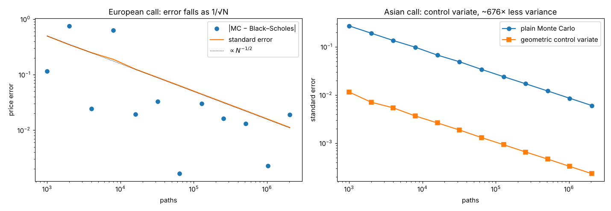
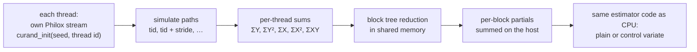

# cuda-mc-pricer

Monte Carlo option pricing on the GPU with CUDA, plus a matching CPU implementation, validated
against closed-form prices. It covers European options, and arithmetic-average Asian options with a
geometric-Asian **control variate** that cuts the variance by about 680×. It has been run on an
RTX 4050 Laptop GPU, where 100 M paths price the Asian option to a standard error of 3.3 × 10⁻⁵ in
under a second.



## What it computes

- **European call/put**, checked against Black–Scholes.
- **Arithmetic Asian call** with 12 monthly fixings. It has no closed form, so it is the reason to use
  Monte Carlo at all.
- **Control variate.** The *geometric*-average Asian call is almost perfectly correlated with the
  arithmetic one, and it **does** have an exact price, because the log of a geometric average of
  lognormals is normal:

  $$\ln G \sim \mathcal N\!\left(\ln S_0 + (r - q - \tfrac{\sigma^2}{2})\tfrac{T(n+1)}{2n},\ \ \sigma^2 T\tfrac{(n+1)(2n+1)}{6n^2}\right)$$

  The estimator is $\bar Y - b(\bar X - \mathbb E[X])$ with $b = \mathrm{Cov}(X,Y)/\mathrm{Var}(X)$.
  Its variance is $\mathrm{Var}(Y)(1-\rho^2)$, and here ρ is about 0.9993.

Results from the CPU path (1 M paths, S = 100, K = 105, r = 5 %, q = 2 %, σ = 25 %, T = 1):

| | price | std. error |
|---|---:|---:|
| Black–Scholes call (exact) | 8.941176 | |
| Monte Carlo European call | 8.952382 | 0.016036 |
| Asian call, plain Monte Carlo | 4.571189 | 0.008604 |
| Asian call, with control variate | **4.574266** | **0.000332** |

The control variate reaches the accuracy of about 670 M plain paths using 1 M paths.

## Measured on a GPU

An NVIDIA GeForce RTX 4050 Laptop GPU (Ada, sm_89) under Windows 11, built with nvcc 13.4 and
MSVC 14.50. The CPU rows are the same program's **single-threaded** CPU path on the laptop's AMD
Ryzen 7 7735HS, so the last column compares the whole GPU with one CPU core. Times are wall-clock
per call after a warm-up call, and include the device allocation and the copy-back of the
per-block sums.

| | paths | price | std. error | time | paths per second |
|---|---:|---:|---:|---:|---:|
| European call, CPU | 1 M | 8.952382 | 0.016036 | 0.038 s | 26 M |
| European call, GPU | 100 M | 8.939036 | 0.001601 | 0.080 s | 1.25 G (48×) |
| Asian call with control variate, CPU | 1 M | 4.574332 | 0.000332 | 0.412 s | 2.4 M |
| Asian call with control variate, GPU | 100 M | 4.573932 | 0.000033 | 0.914 s | 109 M (45×) |

The GPU European price is 1.3 standard errors from Black–Scholes (8.941176), and the GPU and CPU
Asian prices agree to 1.2 CPU standard errors. All four GPU tests pass on this card.

The Windows CPU Asian price differs slightly from the Linux one in the table above (4.574332 vs
4.574266). `std::normal_distribution`'s algorithm is implementation-defined, so MSVC and GCC draw
different normal streams from the same `mt19937_64` seed. The difference is a fifth of a standard
error.

## GPU design



- **Random numbers.** Counter-based Philox (cuRAND device API, header-only). Each thread gets an
  independent subsequence, so there are no shared generator states and no synchronisation.
- **Reduction.** Every thread accumulates the five sums the control-variate estimator needs. They
  are tree-reduced in shared memory, so each block writes one record and the host adds about 1,000 of
  them. The final estimator is shared code: the CPU and GPU paths differ only in how the sums are
  produced.
- **Exact sampling.** GBM is sampled exactly at each fixing,
  $\ln S_{t+\Delta} = \ln S_t + (r-q-\tfrac{\sigma^2}{2})\Delta + \sigma\sqrt\Delta Z$, so there is no
  time-discretisation bias, only statistical error.

## Build, test and run

```bash
cmake -S . -B build -DCMAKE_BUILD_TYPE=Release   # CUDA used automatically if nvcc is found
cmake --build build -j
ctest --test-dir build --output-on-failure
./build/mc_pricer
./build/mc_pricer --convergence docs/convergence.csv && python scripts/plot_convergence.py
```

Without nvcc (or with `-DMCP_USE_CUDA=OFF`) the GPU entry points become stubs and everything else
builds.

By default the kernels are built for sm_75 to sm_89, plus sm_70 with CUDA 12 or older (CUDA 13
dropped Volta). To build for one card only, configure a fresh build directory with, for example,
`-DCMAKE_CUDA_ARCHITECTURES=89` for an RTX 40-series GPU. CI compiles the kernels in an NVIDIA CUDA
12.4 container; the GPU numbers above were built without CMake, from a Visual Studio x64 developer
prompt:

```bat
nvcc -O3 -std=c++17 -arch=sm_89 -Iinclude src/model.cpp src/cpu.cpp src/gpu.cu app/main.cpp -o mc_pricer.exe
```

## Tests

| test (CPU, always run) | what it checks |
|---|---|
| European call and put | within 4 standard errors of Black–Scholes (400 k paths) |
| 1/√N | 4× more paths halves the standard error, to within 10 % |
| geometric Asian | Monte Carlo matches the closed form, validating the path simulation |
| control variate | agrees with the plain estimate and cuts variance by more than 20× (measured: 680×) |
| AM ≥ GM | the arithmetic Asian is worth at least the geometric |
| one fixing | the geometric Asian formula reduces exactly to Black–Scholes |

GPU tests (`tests/test_gpu.cpp`) repeat the checks with 2–4 M GPU paths and compare the GPU and
CPU prices. Without a device they exit with code 77, which CTest reports as *skipped*.

## License

MIT
