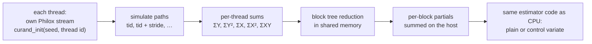

# cuda-mc-pricer

Monte Carlo option pricing on the GPU with CUDA, plus a matching CPU implementation, validated
against closed-form prices. It covers European options, and arithmetic-average Asian options with a
geometric-Asian **control variate** that cuts the variance by about 680×.


## What it computes

- **European call/put**, checked against Black–Scholes.
- **Arithmetic Asian call** with 12 monthly fixings. It has no closed form, so it is the reason to use
  Monte Carlo at all.
- **Control variate.** The *geometric*-average Asian call is almost perfectly correlated with the
  arithmetic one, and it **does** have an exact price, because the log of a geometric average of
  lognormals is normal:

  $$\ln G \sim \mathcal N\!\left(\ln S_0 + (r - q - \tfrac{\sigma^2}{2})\tfrac{T(n+1)}{2n},\ \ \sigma^2 T\tfrac{(n+1)(2n+1)}{6n^2}\right)$$

  The estimator is $\bar Y - b(\bar X - \mathbb E[X])$ with $b = \mathrm{Cov}(X,Y)/\mathrm{Var}(X)$.
  Its variance is $\mathrm{Var}(Y)(1-\rho^2)$, and here ρ is about 0.9993.

Results from the CPU path (1 M paths, S = 100, K = 105, r = 5 %, q = 2 %, σ = 25 %, T = 1):

| | price | std. error |
|---|---:|---:|
| Black–Scholes call (exact) | 8.941176 | |
| Monte Carlo European call | 8.952382 | 0.016036 |
| Asian call, plain Monte Carlo | 4.571189 | 0.008604 |
| Asian call, with control variate | **4.574266** | **0.000332** |

The control variate reaches the accuracy of about 670 M plain paths using 1 M paths.

## GPU design



- **Random numbers.** Counter-based Philox (cuRAND device API, header-only). Each thread gets an
  independent subsequence, so there are no shared generator states and no synchronisation.
- **Reduction.** Every thread accumulates the five sums the control-variate estimator needs. They
  are tree-reduced in shared memory, so each block writes one record and the host adds about 1,000 of
  them. The final estimator is shared code: the CPU and GPU paths differ only in how the sums are
  produced.
- **Exact sampling.** GBM is sampled exactly at each fixing,
  $\ln S_{t+\Delta} = \ln S_t + (r-q-\tfrac{\sigma^2}{2})\Delta + \sigma\sqrt\Delta Z$, so there is no
  time-discretisation bias, only statistical error.

## Build, test and run

```bash
cmake -S . -B build -DCMAKE_BUILD_TYPE=Release   # CUDA used automatically if nvcc is found
cmake --build build -j
ctest --test-dir build --output-on-failure
./build/mc_pricer
./build/mc_pricer --convergence docs/convergence.csv && python scripts/plot_convergence.py
```

Without nvcc (or with `-DMCP_USE_CUDA=OFF`) the GPU entry points become stubs and everything else
builds.

**Honest status.** The kernels compile cleanly with nvcc for sm_70, 75, 80 and 86 (Volta to
Ampere), and CI builds them in an NVIDIA CUDA container. The machine this was developed on has no
GPU, so the numbers above come from the CPU path, and no GPU timings are claimed. On a machine with
an NVIDIA GPU, `ctest` runs the GPU tests automatically: prices within 4 standard errors of the
closed forms, and agreement with the CPU. `mc_pricer` then prints GPU timings and the speed-up over
the CPU.

## Tests

| test (CPU, always run) | what it checks |
|---|---|
| European call and put | within 4 standard errors of Black–Scholes (400 k paths) |
| 1/√N | 4× more paths halves the standard error, to within 10 % |
| geometric Asian | Monte Carlo matches the closed form, validating the path simulation |
| control variate | agrees with the plain estimate and cuts variance by more than 20× (measured: 680×) |
| AM ≥ GM | the arithmetic Asian is worth at least the geometric |
| one fixing | the geometric Asian formula reduces exactly to Black–Scholes |

GPU tests (`tests/test_gpu.cpp`) repeat the checks with 2–4 M GPU paths and compare the GPU and
CPU prices. Without a device they exit with code 77, which CTest reports as *skipped*.

## License

MIT
